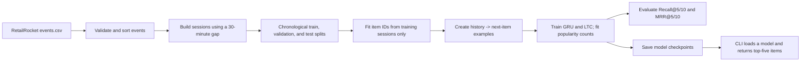

# Project Guide: Session-Based Recommendation with Liquid Neural Networks

This guide explains the project in plain language: what problem it solves,
what its files do, how the models work, how to run the project, and how to
understand its results.

## 1. What does this project do?

An online store can use a visitor's recent actions to guess which item they
might look at next. This project makes that guess from the items in the
visitor's current session.

For example, if a session contains:

```text
Laptop -> Mouse -> Keyboard
```

the system ranks items that could come next. It does not identify the visitor:
RetailRocket uses anonymous visitor and item IDs.

The project compares three recommenders:

1. **Popularity**: ranks items by how often they appeared in the training
   sessions.
2. **GRU**: learns patterns in an ordered sequence of items using a Gated
   Recurrent Unit.
3. **LTC**: learns a sequence using a Liquid Time-Constant recurrent network.
   This is the main model being studied.

All three models use the training data's item catalogue. They do not recommend
items that were never present in the training vocabulary.

## 2. How the project works



For a session `[A, B, C, D]`, preprocessing creates examples like:

```text
[A]       -> B
[A, B]    -> C
[A, B, C] -> D
```

Each row is one prediction problem: given a history, rank the next item.

## 3. Dataset

The project uses RetailRocket's public e-commerce clickstream dataset:

- [RetailRocket dataset on Kaggle](https://www.kaggle.com/datasets/retailrocket/ecommerce-dataset)
- The relevant file is `events.csv`.
- Required columns are `timestamp`, `visitorid`, `event`, and `itemid`.
- Timestamps are Unix time in milliseconds.
- Event types include `view`, `addtocart`, and `transaction`. The current
  pipeline treats each valid event as an interaction; it does not assign
  different weights to event types.

The Kaggle page lists the dataset as **CC BY-NC-SA 4.0**. Review and follow
that license before copying or redistributing the dataset. This repository
does not include the downloaded dataset. The item-property and category-tree
files are not needed for the implemented experiments.

Put the extracted event file here:

```text
data/raw/archive/events.csv
```

### What preprocessing does

`src/data.py`:

1. Checks that the required columns exist and removes rows with missing IDs or
   invalid timestamps.
2. Orders events for each visitor by timestamp.
3. Starts a new session when the gap between events is **more than 30 minutes**.
4. Drops sessions shorter than two interactions.
5. Splits whole sessions into chronological training, validation, and test
   windows. Sessions crossing a split boundary are discarded so one session
   cannot leak across splits.
6. Learns the item vocabulary and minimum item frequency from the training
   split only. Internal item index `0` is reserved for padding.
7. Creates prefix-to-target examples. Unknown items in held-out sessions are
   excluded from mapped examples, and unavailable validation/test target
   occurrences are counted in the report.
8. Saves elapsed-time features for the LTC. These use only timestamps from
   events already in the input history. No target timestamp or future time gap
   is included. The first observed event uses a 1-second reference interval
   because there is no earlier event in the supplied history.

## 4. Models

### Popularity baseline

This is the simplest comparison. It counts item appearances in training
sessions and ranks the most frequent items first. It does not look at the
current session's sequence. Ties are broken by internal item index.

### GRU recommender

The GRU turns each item index into a learned embedding (a compact vector), then
reads the sequence in order. It uses the hidden representation after the last
real history item to assign scores to every item in the training vocabulary.
Padding ID `0` is ignored as a recommendation.

### LTC recommender

The LTC also embeds items and reads them in order, but its recurrent state
follows continuous-time dynamics. In practical terms, its state can evolve
according to the elapsed time between known events, rather than treating every
observed transition as necessarily having the same duration. The implementation
uses the `LTC` recurrent cell from the `ncps` package and a linear output layer
to score all candidate items.

When timestamps are passed, each time feature is the elapsed time between
consecutive items in the known history. At inference, the time from the final
history item to an unknown future target cannot be known, so it is not used.
Simultaneous events are given a small positive time floor inside the LTC
solver.

Both neural models are trained with cross-entropy loss and Adam. The model
scores the next item from the final valid hidden state. The best checkpoint is
selected by validation loss; test metrics are calculated only after training.

## 5. Project files

```text
session-recommendation-lnn/
├── README.md                 # Quick project overview and results
├── PROJECT_GUIDE.md          # This plain-language explanation
├── requirements.txt          # Python dependencies
├── .gitignore                # Keeps data, checkpoints, and caches out of Git
├── data/
│   ├── raw/                  # Downloaded dataset (not committed)
│   └── processed/            # Generated split files and item mapping
├── src/
│   ├── data.py               # Validation, sessions, splits, examples
│   ├── train.py              # Shared GRU/LTC training process
│   ├── evaluate.py           # Metrics, results JSON, and plots
│   ├── recommend.py          # Command-line inference
│   └── models/
│       ├── popularity.py     # Interaction-frequency baseline
│       ├── gru.py            # GRU recommender and checkpoint loading
│       └── ltc.py            # LTC recommender and checkpoint loading
├── tests/                    # Unit and smoke tests
└── artifacts/
    ├── checkpoints/          # Saved model weights and training histories
    └── figures/              # Evaluation JSON and charts
```

Generated data, checkpoints, and charts are excluded from Git because they
are large and can be recreated by running the project. The local copies used
for the reported experiment are present on the original development machine.

## 6. Setup and run commands

Run commands from the project root. These examples use macOS/Linux shell
syntax. Python 3.10 was used for the completed run.

### Install dependencies

```bash
python3 -m venv .venv
.venv/bin/python -m pip install -r requirements.txt
```

PyTorch automatically uses CUDA when available, then Apple MPS when available,
or CPU otherwise if `--device auto` is used.

### Prepare the data

After putting `events.csv` at `data/raw/archive/events.csv`:

```bash
.venv/bin/python -m src.data \
  --input data/raw/archive/events.csv \
  --output data/processed
```

Optional preprocessing settings include `--session-gap-minutes`,
`--min-session-length`, and `--min-item-support`.

### Train the models

The settings below match the completed comparison run:

```bash
.venv/bin/python -m src.train \
  --model gru --epochs 3 --batch-size 512 \
  --embedding-dim 32 --hidden-size 32 \
  --max-sequence-length 10 --seed 42 --device auto

.venv/bin/python -m src.train \
  --model ltc --epochs 3 --batch-size 512 \
  --embedding-dim 32 --hidden-size 32 \
  --max-sequence-length 10 --seed 42 --device auto
```

Training writes the best validation-loss checkpoint and a JSON training
history to `artifacts/checkpoints/`. `--patience` controls early stopping;
`--learning-rate` changes Adam's learning rate. The default maximum history
length is 50, so use `--max-sequence-length 10` to reproduce the reported
experiment.

### Evaluate all three models

Run evaluation after both neural models have checkpoints:

```bash
.venv/bin/python -m src.evaluate \
  --device auto --batch-size 512 --max-sequence-length 10
```

This fits and saves the popularity baseline, evaluates all three models on
the same test examples, writes the results JSON, and creates the two charts.

### Get recommendations

Use original RetailRocket item IDs, separated by commas:

```bash
.venv/bin/python -m src.recommend \
  --model ltc \
  --items 461686,257040,309778
```

The default model is `ltc`. You can choose `--model gru` or
`--model popularity`. For LTC, optional Unix-millisecond timestamps—one per
input item—enable observed elapsed-time features:

```bash
.venv/bin/python -m src.recommend \
  --model ltc \
  --items 461686,257040,309778 \
  --timestamps-ms 1433221332117,1433221333117,1433221335117
```

Without timestamps, LTC uses its 1-second reference interval. Unknown input
IDs are warned about and skipped; the program reports an error if none of the
supplied items are in the training vocabulary. The recommendation scores are
normalized training counts for popularity and softmax probabilities for the
neural models. They are model scores, not guaranteed real-world purchase
probabilities.

### Run tests

```bash
.venv/bin/python -m unittest discover -s tests -v
```

The tests cover session creation, chronological splits, unknown items,
timestamp features, output shapes, gradients, checkpoints, metrics, and
recommendation input validation. Synthetic data is used only for software
tests, not as recommendation-quality evidence.

## 7. Evaluation results

The measured results are also saved in
`artifacts/figures/test_metrics.json`.

| Model | Recall@5 | Recall@10 | MRR@5 | MRR@10 |
|---|---:|---:|---:|---:|
| Popularity | 0.0064 | 0.0114 | 0.0044 | 0.0051 |
| GRU | 0.1886 | 0.2155 | 0.1455 | 0.1491 |
| LTC | 0.2432 | 0.2680 | 0.1993 | 0.2027 |

- **Recall@K** answers: “How often was the correct next item somewhere in the
  first K recommendations?”
- **MRR@K** rewards correct items that appear near the top. A rank of 1
  contributes 1, rank 2 contributes 1/2, and a miss in the first K contributes
  0.

The evaluation used **61,389 mapped test examples**, the same set of **41,261
candidate items**, and the most recent **10 history items** for each example.
Another **27,137 test target occurrences** were not in the training vocabulary
and therefore could not be scored by any of these models; they are counted in
the preprocessing report and excluded from the reported metric denominator.

On this specific split and training setup, LTC scored higher than GRU and
popularity on all four metrics. This does not prove that LTC is always better.
The results are limited to this dataset, split, vocabulary, history cap, and
training configuration. This project is a focused student experiment, not a
deployed recommendation service or a broad benchmark.

Charts:

- `artifacts/figures/training_validation_loss.png`
- `artifacts/figures/test_metrics_comparison.png`

## 8. Important notes

- The public GitHub repository contains source code and tests, not the dataset
  or generated checkpoints and plots. Download RetailRocket and run the
  commands above to recreate them.
- If `events.csv` is missing, preprocessing cannot run. If checkpoints are
  missing, evaluation and neural inference cannot run until the models are
  trained.
- The dataset is licensed CC BY-NC-SA 4.0 according to the Kaggle listing;
  comply with its current terms when using or sharing the data.
- The project implements session-level next-item recommendation only. It does
  not include a website, database, user accounts, or live event collection.
